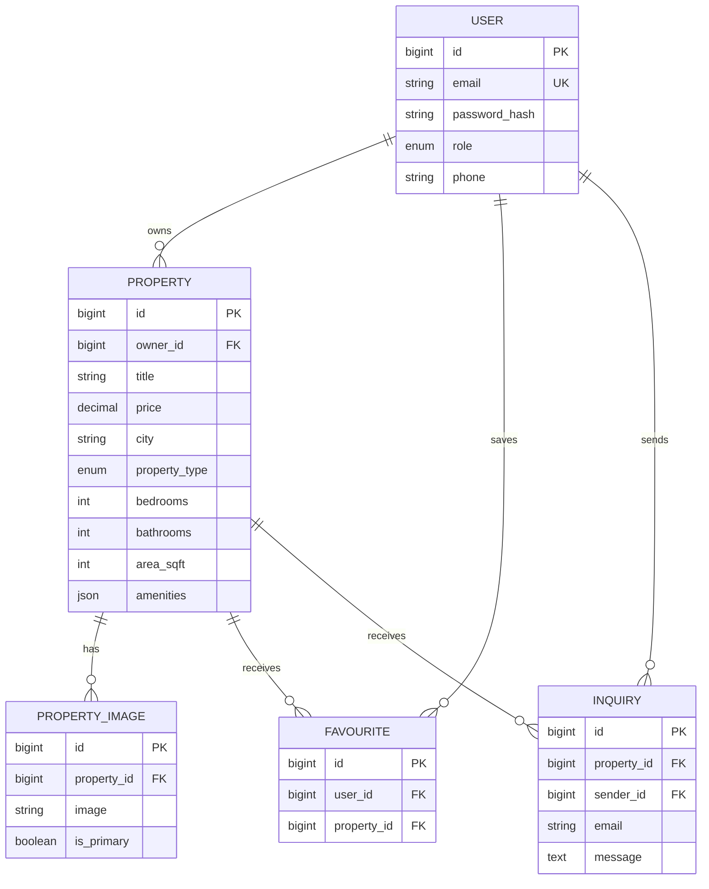

# Architecture and database design

## Components

- **React SPA:** navigation, discovery, details, account and agent workflows.
- **API client:** JSON/multipart requests, bearer headers, token refresh and normalized failures.
- **Django REST API:** serializers provide validation; viewsets expose REST resources; permissions enforce roles and ownership.
- **PostgreSQL:** authoritative relational data store. SQLite is only the local zero-configuration fallback.
- **Media:** filesystem in development; persistent S3-compatible storage is required in production.

## ER diagram

`Favourite(user_id, property_id)` has a unique database constraint. Property discovery uses an index over city, property type and price. Foreign-key deletion behaviour is explicit: owned listings and their dependent media/favourites are deleted with an owner/property, while inquiry senders become null to retain an agent's business record.
