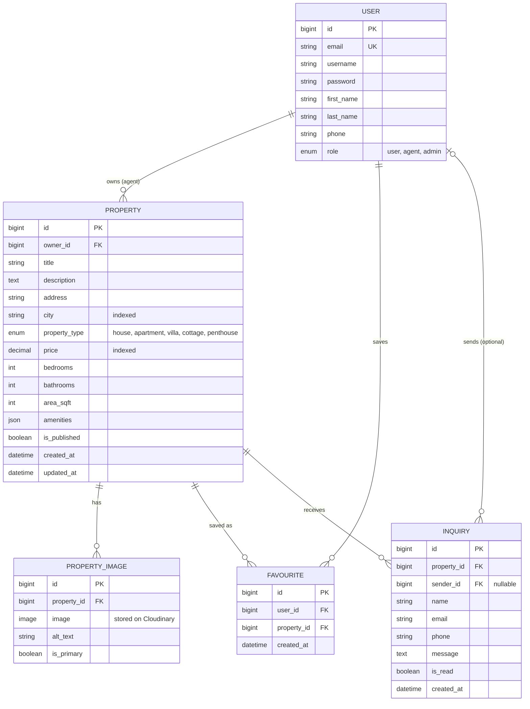

# Architecture and database design

## Components

| Component | Responsibility |
|---|---|
| **React single-page app** (Vercel) | Navigation, discovery, property details, account, agent dashboard and listing form |
| **API client** (`src/api.ts`) | JSON and multipart requests, bearer headers, single automatic token refresh, normalized errors |
| **Data layer** (`src/hooks`, `src/lib`) | Hooks that load listings, enquiries and favourites with loading and error state; a mapper that converts API fields into the shapes the pages use |
| **Django REST API** (Render) | Serializers validate input, viewsets expose REST resources, permissions enforce roles and ownership |
| **PostgreSQL** (Render) | Authoritative relational store. SQLite is only the zero-setup local fallback |
| **Cloudinary** | Durable storage for property photos (Render's disk is wiped on restart). Local `backend/media/` is used in development |

## Request flow

```text
1. Visitor opens https://hexagon-homes.vercel.app          (static React build, served by Vercel)
2. The app calls   GET  <API>/properties/?city__icontains=...&ordering=price&page=2
3. Django filters, orders and paginates (12 per page), returns {count, next, previous, results}
4. The mapper turns each result into a card; Cloudinary serves the photos directly to the browser
5. Logged-in actions send  Authorization: Bearer <access token>
   An expired token triggers one refresh call, then the original request is retried
```

## Authentication and roles

- Registration and login return a JWT pair (access token 15 minutes, refresh token 7 days, rotating and blacklisted at logout).
- The user model uses the email address as the login name and has a `role`: `user` (buyer), `agent` or `admin`. Superusers are given the admin role automatically; admin accounts cannot be self-registered.
- Authorization is enforced in the API: collection-level role checks (only agents and admins can create listings) and object-level ownership checks (only the owner or an admin can change a listing). Route guards in the React app are a convenience only.

## ER diagram




## Data integrity decisions

| Decision | Why |
|---|---|
| `Favourite(user, property)` has a unique constraint | A home can be saved only once per account, enforced by the database and not only by the interface |
| Index on `city`, `property_type`, `price` (single and combined) | Supports the location, type and price filters and sorting |
| Deleting a user deletes their listings; deleting a listing deletes its photos, favourites and enquiries | No orphaned rows (`CASCADE`) |
| `Inquiry.sender` becomes null if the sender's account is deleted | The agent keeps the business record of the enquiry (`SET NULL`) |
| Images are validated for type (JPEG, PNG, WebP) and size (8 MB) on the server | Bad uploads are rejected by the server, not just the browser |
| Only the first uploaded photo of a listing is marked primary | The cover photo is predictable |
| `price` is a fixed-point decimal and is sent to the browser as text | Avoids floating-point rounding; the mapper converts it to a number for sorting and display |

## Deployment view

```text
GitHub (main) ──push──▶ Vercel  builds the React app (pnpm build → dist), SPA rewrites in vercel.json
              └─push──▶ Render  runs: pip install → collectstatic → migrate → gunicorn config.wsgi
                                 │
                                 ├── DATABASE_URL    → Render PostgreSQL
                                 └── CLOUDINARY_URL  → Cloudinary (uploads)
```

Production settings (when `DJANGO_DEBUG=false`) add WhiteNoise for static files, a trusted proxy header so HTTPS redirects work behind Render, HSTS, secure cookies and clickjacking protection.
